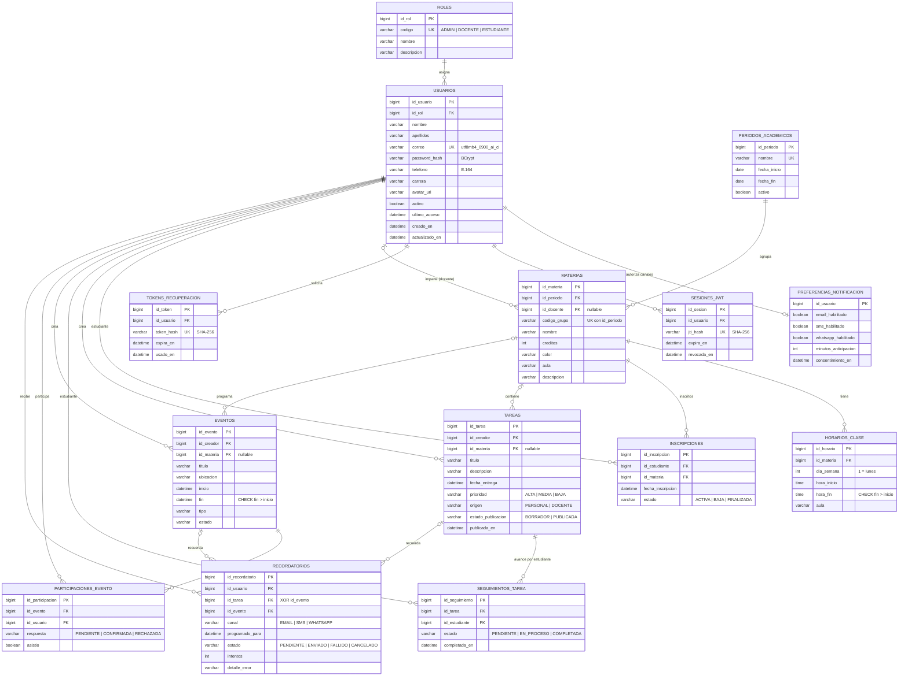

<p align="center">
  
</p>

<h1 align="center">Dianova</h1>
<p align="center"><b>Sistema web de planificación académica y gestión de tareas, eventos y recordatorios para estudiantes.</b><br/>
Spring Boot · React · MySQL 8 · JWT · Correo con Postfix · SMS y WhatsApp con Twilio</p>

---

## Equipo y enlaces

| | |
|---|---|
| Integrantes | **[NOMBRE COMPLETO INTEGRANTE 1]** · **[NOMBRE COMPLETO INTEGRANTE 2]** |
| Número de equipo | **[N.º DE EQUIPO]** |
| Proyecto desplegado (HTTPS) | **[https://TU-DOMINIO](https://TU-DOMINIO)** |
| URL base de la API | **`https://TU-DOMINIO/api`** (salud: `GET /api/salud`) |
| Repositorio | https://github.com/pavelrami/Dianova |
| Tablero GitHub Projects | **https://github.com/users/pavelrami/projects/3** (columnas Backlog, To Do, In Progress, In Review, Done) |
| Prototipo navegable en Figma | https://www.figma.com/design/Sz5DqCOxJm5mjzAloVFSTB/Login |

## Descripción

Dianova centraliza **materias, horarios, tareas, entregas, eventos y recordatorios** de una escuela. Resuelve un problema real: la información académica vive dispersa (chats, correos, libretas) y los estudiantes se enteran tarde de las entregas.

- **Estudiante:** ve únicamente sus datos y los de las materias en que está inscrito; crea tareas personales, actualiza su avance, consulta su calendario, confirma asistencia a eventos y programa recordatorios por correo, SMS o WhatsApp.
- **Docente:** publica tareas (borrador → publicada) y eventos de las materias que imparte; cada estudiante inscrito recibe su propio seguimiento y un aviso por los canales que autorizó; consulta inscritos, avance y asistencia.
- **Administrador:** acceso total: gestiona usuarios y roles, periodos, materias, horarios, inscripciones y supervisa los envíos.

Regla clave del modelo: **una tarea o evento nunca se muestra solo por conocer su ID**; el backend siempre verifica autoría, matrícula, docencia o rol de administrador.

## Tecnologías

| Capa | Tecnología |
|---|---|
| Backend | Java 21, **Spring Boot 3.5.16** (Web, Security, Data JPA, Validation, Mail, Actuator), **JWT** (jjwt 0.12.6), BCrypt |
| Base de datos | **MySQL 8** (no MariaDB), migraciones **Flyway**, `ddl-auto=validate` |
| Frontend | **React 19 + Vite 8**, React Router 7, **Axios**, Tailwind CSS 4, lucide-react, GSAP 3.13.0 + Lenis 1.3.11 (solo la portada pública) |
| Comunicación | **Postfix + OpenDKIM** en el VPS (JavaMailSender), **Twilio** (SMS y WhatsApp) vía API REST |
| Pruebas de API | **Bruno** (carpeta `bruno/` versionada) |
| Despliegue | VPS Ubuntu, **Nginx**, **Certbot / Let's Encrypt**, JAR con **systemd**, build estático de React |

## Credenciales de prueba

Las carga `DemoDataSeeder` (perfil `demo`) junto con 20 usuarios, 14 materias, 30 tareas, 15 eventos y más datos de ejemplo.

| Rol | Correo | Contraseña |
|---|---|---|
| **Administrador (evaluación)** | `admin@dianova.test` | `Admin#2026` |
| Docente | `docente@dianova.test` | `Docente#2026` |
| Estudiante | `estudiante@dianova.test` | `Estudiante#2026` |

Otros docentes (`esantos@`, `rcastillo@`, `csilva@`, `dortega@dianova.test`) usan `Docente#2026` y los demás estudiantes usan `Estudiante#2026`. Los correos de demostración usan el dominio reservado **`.test`**, que **nunca** se envía. Para probar el envío real, registra una cuenta con tu correo y tu teléfono.

---

## Diagrama Entidad-Relación

14 tablas en 3FN. Las relaciones **N:M** se resuelven con entidades asociativas porque guardan datos propios de la relación:
**estudiante ↔ materia** (`inscripciones`), **estudiante ↔ tarea** (`seguimientos_tarea`) y **usuario ↔ evento** (`participaciones_evento`).



Restricciones destacadas: correo único sin distinguir mayúsculas; `UNIQUE(id_periodo, codigo_grupo)`; `UNIQUE(id_estudiante, id_materia)`; `UNIQUE(id_tarea, id_estudiante)`; `UNIQUE(id_evento, id_usuario)`; `CHECK` de rangos de fechas y horas; `CHECK ((id_tarea IS NULL) <> (id_evento IS NULL))` en recordatorios.

Diagramas del documento de modelado: [E-R conceptual](docs/diagramas/er-conceptual.png) · [relacional académico](docs/diagramas/relacional-academico.png) · [relacional de seguridad](docs/diagramas/relacional-seguridad.png) · [casos de uso](docs/diagramas/casos-de-uso.png) · [flujo de publicar tarea](docs/diagramas/flujo-publicar-tarea.png) · [estados de la tarea](docs/diagramas/estados-tarea.png) · [arquitectura en el VPS](docs/diagramas/arquitectura-vps.png).

## Roles y permisos

| Recurso | Administrador | Docente | Estudiante |
|---|---|---|---|
| Usuarios y roles (`/api/admin/**`) | CRUD | — | — |
| Periodos | CRUD | Ver | Ver |
| Materias, horarios | CRUD | Ver las que imparte | Ver en las que está inscrito |
| Inscripciones (N:M) | CRUD | Ver inscritos de sus materias | — |
| Tareas | CRUD de todas | CRUD y publicar en sus materias; ver avance del grupo | Tareas personales; actualizar su avance |
| Eventos | CRUD de todos | Eventos de sus materias (invita a los inscritos); asistencia | Eventos personales; confirmar/rechazar invitaciones |
| Recordatorios | Supervisar todos, reintentar | Propios | Propios |

La autorización se aplica en tres capas: **SecurityFilterChain** (por ruta: `/api/admin/**` solo ADMIN), **`@PreAuthorize`** en los controladores y **verificación de pertenencia** en los servicios (`Permisos.java`). En React, `RutaPrivada` y `RutaRol` protegen las rutas y el menú cambia según el rol.

---

## Estructura del repositorio

```
backend/            API Spring Boot (Maven wrapper incluido)
  src/main/java/com/dianova/
    config/         Seguridad, CORS, propiedades
    security/       JWT, filtro, sesiones revocables
    domain/         Entidades JPA (14 tablas)
    repository/     Consultas JPQL con JOIN FETCH y filtros del servidor
    dto/            DTO de entrada (Bean Validation) y de salida
    service/        Reglas de negocio y permisos
    notificacion/   Correo (Postfix), Twilio (SMS/WhatsApp), despachador programado
    web/            @RestController
    exception/      @RestControllerAdvice con JSON y códigos 400/401/403/404/422/500
    seed/           DemoDataSeeder (CommandLineRunner, perfil demo)
  src/main/resources/
    db/migration/   V1__crear_esquema.sql, V2__catalogo_roles.sql (Flyway)
    application.properties.example
frontend/           React + Vite (build estático)
bruno/              Colección de pruebas de la API
database/           dianova_respaldo.sql y consultas_ejemplo.sql
deploy/             Nginx, systemd, OpenDKIM, script y guía del VPS
docs/diagramas/     Diagramas del modelado
imagenes/           Pantallas del prototipo de Figma
```

## Instalación local

Requisitos: **JDK 21+**, **Node 20.19+**, **MySQL 8**.

```bash
# 1. Base de datos (las tablas las crea Flyway al arrancar)
mysql -u root -p -e "CREATE DATABASE dianova CHARACTER SET utf8mb4 COLLATE utf8mb4_0900_ai_ci;"

# 2. Backend
cd backend
cp src/main/resources/application.properties.example src/main/resources/application.properties
#    edita: usuario/contraseña de MySQL, dianova.jwt.secreto (openssl rand -base64 48), URLs
./mvnw spring-boot:run          # Windows: mvnw.cmd spring-boot:run  ->  http://localhost:8080/api

# 3. Frontend (otra terminal)
cd frontend
npm install
npm run dev                     # http://localhost:5173  (redirige /api al backend)
```

Para restaurar el respaldo en lugar de usar el seeder: `mysql -u root -p < database/dianova_respaldo.sql`.

## API REST (resumen)

Base: `/api`. Todas las rutas, salvo las marcadas como públicas, requieren `Authorization: Bearer <JWT>`. Los listados son **paginados en el servidor** (`page`, `size` ≤ 50) y reciben los **filtros como parámetros**; responden `{ contenido, pagina, tamano, totalElementos, totalPaginas, primera, ultima }`.

| Método y ruta | Descripción |
|---|---|
| `POST /auth/login` · `POST /auth/registro` (públicas) | Devuelven `{ token, tipo, expiraEn, usuario }` |
| `POST /auth/logout` | Revoca el JWT actual (`sesiones_jwt`) |
| `POST /auth/recuperar` · `POST /auth/restablecer` (públicas) | Enlace por correo (token SHA-256, 30 min) y nueva contraseña |
| `GET /auth/yo` · `PUT /perfil` · `PUT /perfil/contrasena` · `GET/PUT /perfil/preferencias` | Cuenta propia y consentimiento de canales |
| `GET /resumen` · `GET /calendario?desde&hasta&materiaId` | Panel por rol y calendario combinado |
| `GET/POST /tareas` · `GET/PUT/DELETE /tareas/{id}` | Filtros: `q, materiaId, prioridad, estado, pendientes, publicacion, origen, desde, hasta, orden, dir` |
| `POST /tareas/{id}/publicar` · `PATCH /tareas/{id}/progreso` · `GET /tareas/{id}/seguimientos` | Flujo borrador → publicada y avance por estudiante |
| `GET/POST /eventos` · `PUT/DELETE /eventos/{id}` · `POST /eventos/{id}/respuesta` | Eventos, invitaciones y respuesta |
| `GET /eventos/{id}/participantes` · `PATCH /eventos/{id}/participantes/{pid}/asistencia` | Invitados y asistencia |
| `GET/POST /recordatorios` · `PATCH /recordatorios/{id}/cancelar` · `POST /recordatorios/{id}/enviar` · `DELETE` | Programar, cancelar y **enviar ahora** |
| `GET/POST /materias` · `PUT/DELETE /materias/{id}` · `/materias/{id}/horarios` · `/materias/{id}/inscripciones` | Materias, horarios e inscripciones |
| `GET/POST /periodos` · `PUT/DELETE /periodos/{id}` | Periodos académicos |
| `GET/POST /admin/usuarios` · `PUT/DELETE /admin/usuarios/{id}` · `PATCH .../estado` · `GET /admin/roles` · `GET /admin/recordatorios` | Administración |

Formato de error:

```json
{ "fecha": "2026-11-23T10:00:00", "estado": 400, "error": "Bad Request",
  "mensaje": "Revisa los datos marcados", "ruta": "/api/auth/registro",
  "errores": { "correo": "Escribe un correo válido", "contrasena": "La contraseña debe incluir al menos un número" } }
```

## Pruebas con Bruno

La colección está en [`bruno/`](bruno/). Ábrela en Bruno (*Open Collection*), elige el entorno **Local** o **VPS** y ejecuta las carpetas en orden: `01 Autenticacion` guarda los tokens de cada rol y las demás los envían en el header. Incluye login y token, peticiones protegidas por módulo y la carpeta **`08 Errores a proposito`** (401 sin token, 401 contraseña incorrecta, 403 estudiante en ruta de admin, 403 docente en materia ajena, 404, 400 datos inválidos, 400 rango de fechas, 422 correo repetido, 422 canal sin consentimiento).

Desde la terminal: `cd bruno && npx @usebruno/cli run --env Local` → resultado verificado: **48 peticiones, 71 pruebas aprobadas**.

## Seguridad

- Contraseñas con **BCrypt (costo 12)**; requisitos (8+, mayúscula, número, especial) validados en el **frontend bajo el input** y en el **backend con Bean Validation** (`@ContrasenaSegura`).
- **JWT HS256** con `jti`; cada sesión se registra en `sesiones_jwt` (hash SHA-256) y el **logout la revoca**. Cambiar o restablecer la contraseña y desactivar una cuenta cierran sus sesiones.
- Validaciones de entrada solo con Bean Validation en DTOs (`@Valid`, `@NotBlank`, `@Size`, `@Email`, `@Pattern`, `@Future` y restricciones propias `@RangoValido`, `@DestinoUnico`). Sin validaciones manuales en controladores.
- La API **nunca expone entidades JPA**: responde DTOs. Relaciones `LAZY` y consultas con `JOIN FETCH` + consultas agregadas por página para evitar **N+1** (`default_batch_fetch_size=50`, `open-in-view=false`).
- Secretos solo en `application.properties` (ignorado por Git). El repo incluye [`application.properties.example`](backend/src/main/resources/application.properties.example).

## Comunicación con el usuario

| Canal | Implementación | Acción real que lo dispara |
|---|---|---|
| Correo | `JavaMailSender` → **Postfix local** del VPS, firmado con **DKIM**; SPF + DMARC en DNS | Registro (bienvenida), recuperación de contraseña, cambio de contraseña, tarea publicada, evento programado, recordatorios |
| SMS | Twilio Messages API | Tarea publicada / evento programado (si el estudiante lo autorizó), recordatorios, botón *Enviar ahora* |
| WhatsApp | Twilio WhatsApp (sandbox o número aprobado) | Igual que SMS |

Cada envío queda registrado en `recordatorios` con su estado (`PENDIENTE → ENVIADO | FALLIDO | CANCELADO`), intentos y detalle del error; un despachador `@Scheduled` revisa la cola cada 30 s y reintenta hasta 3 veces los fallos temporales.

## Despliegue en el VPS

Guía paso a paso en [`deploy/GUIA-VPS.md`](deploy/GUIA-VPS.md): MySQL 8, usuario de servicio, `application.properties` en `/etc/dianova`, JAR con **systemd** ([`dianova-api.service`](deploy/systemd/dianova-api.service)), build estático servido por **Nginx** ([`dianova.conf`](deploy/nginx/dianova.conf)), **HTTPS con Certbot**, **Postfix + OpenDKIM** con registros SPF/DKIM/DMARC y Twilio. Para actualizar: `bash deploy/desplegar.sh`.

## Respaldo de la base de datos

[`database/dianova_respaldo.sql`](database/dianova_respaldo.sql) fue generado con `mysqldump` desde MySQL 8.0 con los datos de demostración. [`database/consultas_ejemplo.sql`](database/consultas_ejemplo.sql) contiene las 10 consultas de estudio del modelado.

---

## Diseño (Figma)

El frontend implementa las pantallas del prototipo: **01 Login, 02 Recuperar contraseña, 03 Resumen, 04 Mis tareas, 05 Calendario, 06 Eventos, 07 Recordatorios, 08 Mis materias** y la tabla de gestión de usuarios.

### Paleta y teoría del color

| Color | HEX | Papel |
|---|---|---|
| Espresso | `#442816` | Menú lateral, bloques oscuros, texto sobre mantequilla |
| Crema | `#FDFAEF` | Fondo general (blanco cálido, menos fatiga que el blanco puro) |
| Mantequilla | `#FFE5A8` | Elemento activo, tarjetas destacadas, formulario de acceso |
| Vino | `#711B1A` | Acción principal (botones) y urgencias |
| Caramelo | `#BD9457` | Progreso, clases |
| Canela | `#8D532B` | Exámenes, acentos |
| Salvia | `#CAD8C5` | Completado, grupos de estudio |

- **Esquema análogo cálido** (café → caramelo → mantequilla): colores vecinos en el círculo cromático que transmiten calma, enfoque y la sensación de un escritorio de estudio; reducen la ansiedad asociada a las entregas.
- **Vino como acento de acción**: comparte temperatura con la base pero tiene mayor saturación y menor luminosidad, así el botón principal destaca sin romper la armonía; también comunica urgencia (prioridad alta, entregas).
- **Salvia como contraste frío suave** (complementario atenuado del rojo-café): se reserva para "completado", lo que da una lectura positiva inmediata.
- Contraste comprobado (WCAG AA): blanco sobre vino ≈ 11:1, espresso sobre mantequilla ≈ 11:1, texto `#3B2414` sobre crema ≈ 14:1 y texto secundario `#76604F` sobre crema ≈ 5.6:1.

### Logo y tipografía

El logo (libro abierto + destello de cuatro puntas) está dibujado en SVG por el equipo ([`frontend/public/favicon.svg`](frontend/public/favicon.svg) y `components/ui/Logo.jsx`): el libro representa el orden del estudio y el destello, el logro. El destello reaparece en el botón principal, los avisos y la animación de la portada. Tipografía: **Inter** (variable, servida desde el propio proyecto).

### Movimiento

Personalidad **cálida y precisa**: entradas `power3.out` (`cubic-bezier(.25,1,.5,1)`) de 0.9 s, recorrido de 28 px, escalonado 0.08 s; rebote (`back.out(1.6)`) solo en piezas pequeñas (destello y casillas). Scroll suave con Lenis (inercia 0.1) solo en la portada pública. **Animación firma**: en el planificador de la portada las tareas se marcan una por una, el anillo de progreso se llena y aparece el destello del logo, que vuelve a latir en el botón "Crear mi cuenta". Con *Reducir movimiento* activado no se anima nada y todo se ve completo.
